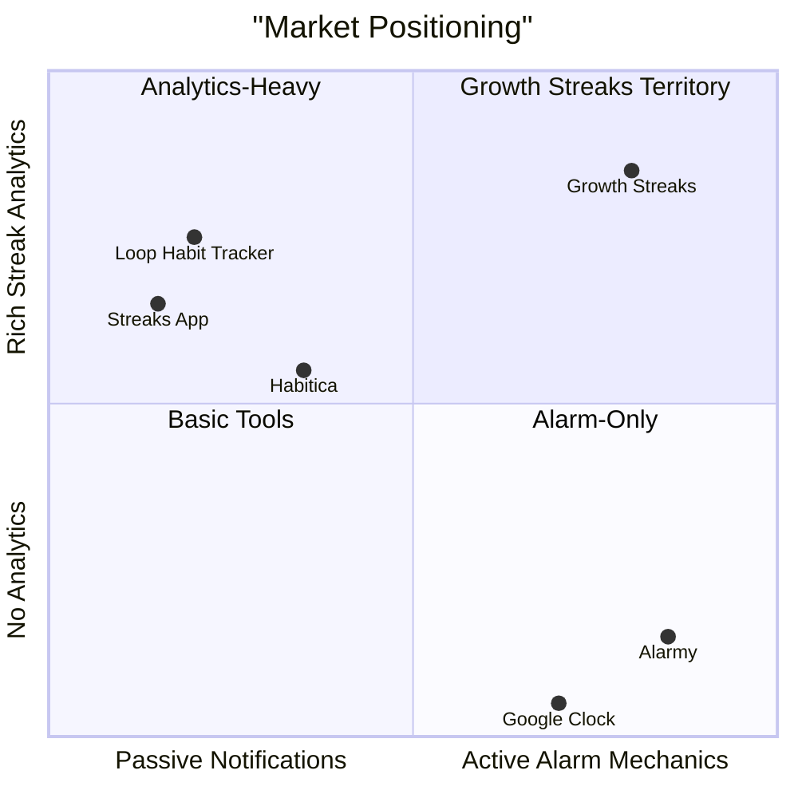
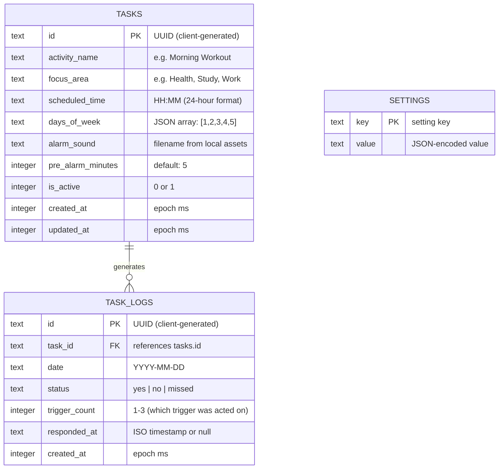
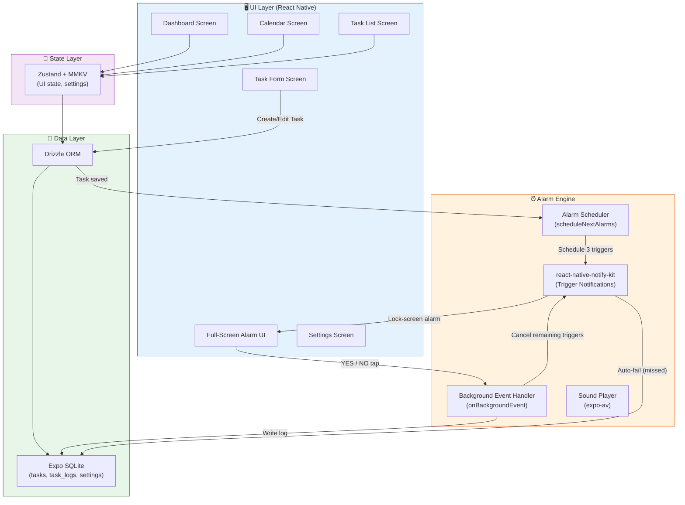
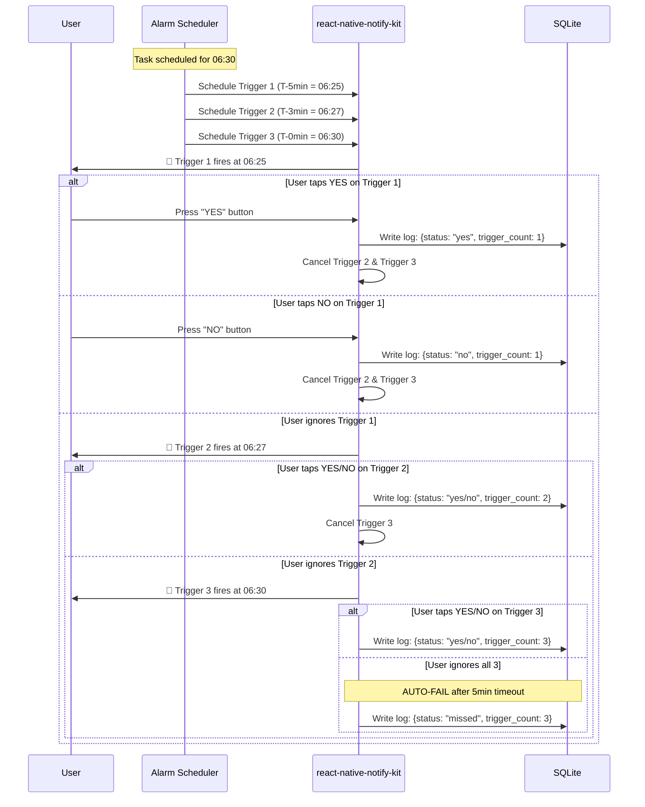
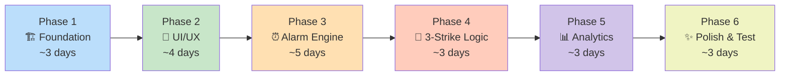

# Growth Streak — Complete Research & Implementation Plan

<p align="center">
  
</p>

> **App Name:** Growth Streak  
> **APK Deliverable Name:** `Growth Streak.apk`  
> **Package ID:** `com.growthstreaks.app`  
> **Category:** Active Accountability Tracker (Lock-Screen Alarm + Habit Streaks)  
> **Platform:** Android 15 (API 35 compliant)  
> **Architecture:** 100% Strictly Offline-First (Local SQLite WAL)  
> **GitHub Repository:** [https://github.com/SakshamRajpoot10/Growth-Streaks.git](https://github.com/SakshamRajpoot10/Growth-Streaks.git)  
> **Last Updated:** November 14, 2026

---

## Executive Summary & Production Deliverables

Growth Streak combines strict 3-strike lock-screen alarm accountability with habit-tracking calendar streaks and fractional success metrics.

### 📦 Production Artifact Deliverables
* **Universal Release APK:** `Growth Streak.apk` (112 MB)
* **Local Workspace File:** [Growth Streak.apk](file:///d:/PROJECTS/Growth%20Streaks/Growth%20Streak.apk)
* **Secondary Workspace Copy:** [growth-streaks/Growth Streak.apk](file:///d:/PROJECTS/Growth%20Streaks/growth-streaks/Growth%20Streak.apk)
* **Cloud Direct Download (EAS CDN):** [Download Growth Streak.apk](https://expo.dev/artifacts/eas/I1P_RSS_ZRI_c5jQd2MokwSeZ3NCu15iws0Lapl2u1U.apk)
* **EAS Cloud Build Dashboard:** [Expo Build `b235a6e8`](https://expo.dev/accounts/sakshamrajpoot/projects/growth-streaks/builds/b235a6e8-e507-42e9-8042-432c2e3818af)
* **Interactive Live Display Tester:** [growth-streaks-tester.html](file:///d:/PROJECTS/Growth%20Streaks/growth-streaks-tester.html)
* **Official Branding:** Integrated `GS` Clock & Streak logo across launcher icons, splash screen, and GitHub badges.
* **Default Theme Architecture:** Default Light Mode out-of-the-box with switchable Obsidian Midnight Dark Mode.

---

## Table of Contents

1. [Market Intelligence](#1-market-intelligence)
2. [Competitive Gap Analysis](#2-competitive-gap-analysis)
3. [Finalized Tech Stack (with Justifications)](#3-finalized-tech-stack)
4. [Database Schema (Complete)](#4-database-schema)
5. [Project Folder Structure](#5-project-folder-structure)
6. [App Architecture Diagram](#6-app-architecture-diagram)
7. [Screen-by-Screen UX Specification](#7-screen-by-screen-ux-specification)
8. [Alarm Engine — 3-Strike System (Complete Logic)](#8-alarm-engine)
9. [Analytics Engine — Streak & Metrics Logic](#9-analytics-engine)
10. [Android Permissions & Play Store Compliance](#10-android-permissions)
11. [Phased Implementation Roadmap](#11-phased-implementation-roadmap)
12. [Testing Strategy](#12-testing-strategy)
13. [Risk Register & Mitigations](#13-risk-register)

---

## 1. Market Intelligence

### Market Size
The habit tracking and productivity app market is valued between **\$1.1B – \$1.6B** and growing at a CAGR of **6.5%–14%**. The alarm clock sub-segment alone (led by Alarmy) generates tens of millions annually.

### Key Trends (2024–2026)
| Trend | Impact on Growth Streaks |
|-------|--------------------------|
| **Anti-Streak Psychology** | Users abandon apps after guilt from breaking streaks. Growth Streaks mitigates this: even 1 completed task keeps the daily streak alive, showing fractional success (8/10) instead of binary pass/fail. |
| **Hybrid Monetization** | Ad-supported free tiers + premium subscriptions dominate. Growth Streaks v1 should be completely free to build user base; v2 can add premium analytics. |
| **Offline-First Privacy** | Users increasingly prefer apps that don't phone home. Growth Streaks is 100% offline — a competitive advantage for privacy-conscious users. |
| **Active vs. Passive Accountability** | Passive notifications (banners) have <5% engagement. Lock-screen alarms with interactive buttons achieve 40%+ engagement. Growth Streaks sits firmly in the "active" category. |

---

## 2. Competitive Gap Analysis



| Feature | Alarmy | Habitica | Loop Habit | **Growth Streaks** |
|---------|--------|----------|------------|---------------------|
| Lock-screen alarm | ✅ | ❌ | ❌ | ✅ |
| Interactive Yes/No on lock screen | ❌ | ❌ | ❌ | ✅ |
| Calendar streak heatmap | ❌ | ❌ (RPG UI) | ✅ | ✅ |
| Weekly % analytics | ❌ | Partial | ✅ | ✅ |
| 3-strike snooze auto-fail | ❌ | ❌ | ❌ | ✅ |
| 100% offline | ❌ (ads) | ❌ (sync) | ✅ | ✅ |
| Custom repetition days | ✅ | ✅ | ✅ | ✅ |
| Focus area tagging | ❌ | Partial | ❌ | ✅ |

> [!IMPORTANT]
> **Growth Streaks' unique value proposition:** It is the only app that combines aggressive lock-screen alarm mechanics with habit-tracking calendar analytics AND automatic accountability (auto-fail on ignore). No competitor does all three.

---

## 3. Finalized Tech Stack

| Layer | Technology | Justification |
|-------|-----------|---------------|
| **Framework** | React Native + Expo (SDK 52+) | Cross-platform, TypeScript support, huge ecosystem. Expo's managed workflow + config plugins avoids ejecting. |
| **Language** | TypeScript (strict mode) | Type safety prevents runtime bugs in alarm scheduling logic. |
| **Routing** | Expo Router v4 (file-based) | Simpler than React Navigation, deep linking for free. |
| **Local Database** | **Expo SQLite** (with Drizzle ORM) | ✅ Winner over WatermelonDB for this use case. The app has <1000 records typically. SQLite is built into Expo, zero extra native config. Drizzle adds type-safe queries + migrations without the complexity of WatermelonDB's reactive model (which is overkill here). |
| **Notifications** | **react-native-notify-kit** (Notifee fork) | ⚠️ Notifee was archived by Invertase. `react-native-notify-kit` is the official drop-in community replacement with identical API, TurboModules support, and all critical features: full-screen intents, interactive action buttons, foreground services, trigger-based scheduling. |
| **State Management** | **Zustand** (with MMKV persist) | ~1KB bundle, zero boilerplate, native MMKV persistence for settings. Massively lighter than Redux Toolkit for an offline app with no API layer. |
| **UI Components** | React Native Paper or Tamagui | Material Design 3 components out of the box. |
| **Calendar Heatmap** | `@symbiot.dev/react-native-heatmap` + custom SVG | GitHub-style contribution graph with daily intensity levels. |
| **Date Utilities** | `date-fns` | Lightweight, tree-shakeable, locale-aware. |
| **Sound** | `expo-av` | Play custom alarm sounds from local assets. |
| **Haptics** | `expo-haptics` | Vibration feedback on alarm interaction. |

> [!WARNING]
> **Critical Architecture Decision — Why NOT WatermelonDB:**  
> WatermelonDB requires native configuration, a custom Expo dev client, and its built-in sync engine is wasted on an offline-only app. Expo SQLite + Drizzle gives you type-safe SQL, automatic migrations, and zero native setup. For an app with ~50–500 task records and ~10K log entries over a year, SQLite is more than sufficient.

---

## 4. Database Schema

### Entity-Relationship Diagram



### Complete SQL Schema

```sql
-- Enable performance optimizations
PRAGMA journal_mode = WAL;
PRAGMA foreign_keys = ON;

-- ============================================
-- TABLE: tasks
-- Stores the definition of each recurring task/alarm
-- ============================================
CREATE TABLE IF NOT EXISTS tasks (
    id                TEXT PRIMARY KEY,       -- UUID v4
    activity_name     TEXT NOT NULL,          -- "Morning Run", "Study Math"
    focus_area        TEXT NOT NULL DEFAULT 'General',  -- "Health", "Study", "Work"
    scheduled_time    TEXT NOT NULL,          -- "06:30" (24h format)
    days_of_week      TEXT NOT NULL DEFAULT '[1,2,3,4,5,6,7]', -- JSON: 1=Mon..7=Sun
    alarm_sound       TEXT NOT NULL DEFAULT 'default_alarm',    -- asset filename
    pre_alarm_minutes INTEGER NOT NULL DEFAULT 5,               -- first trigger offset
    is_active         INTEGER NOT NULL DEFAULT 1,               -- soft toggle
    created_at        INTEGER NOT NULL,      -- Date.now() epoch ms
    updated_at        INTEGER NOT NULL       -- Date.now() epoch ms
);

-- ============================================
-- TABLE: task_logs
-- One row per task per day — the accountability record
-- ============================================
CREATE TABLE IF NOT EXISTS task_logs (
    id              TEXT PRIMARY KEY,         -- UUID v4
    task_id         TEXT NOT NULL,
    date            TEXT NOT NULL,            -- "2026-11-13"
    status          TEXT NOT NULL DEFAULT 'pending',  -- pending | yes | no | missed
    trigger_count   INTEGER NOT NULL DEFAULT 0,       -- 0-3 (how many alarms fired)
    responded_at    TEXT,                     -- ISO timestamp when user tapped Yes/No
    created_at      INTEGER NOT NULL,
    FOREIGN KEY (task_id) REFERENCES tasks(id) ON DELETE CASCADE,
    UNIQUE(task_id, date)                    -- one log per task per day
);

-- ============================================
-- TABLE: settings
-- Key-value store for app preferences
-- ============================================
CREATE TABLE IF NOT EXISTS settings (
    key   TEXT PRIMARY KEY,
    value TEXT NOT NULL     -- JSON-encoded
);

-- ============================================
-- INDEXES for performance
-- ============================================
CREATE INDEX IF NOT EXISTS idx_task_logs_date
    ON task_logs(date);

CREATE INDEX IF NOT EXISTS idx_task_logs_task_date
    ON task_logs(task_id, date);

CREATE INDEX IF NOT EXISTS idx_task_logs_status
    ON task_logs(date, status);

CREATE INDEX IF NOT EXISTS idx_tasks_active
    ON tasks(is_active);

CREATE INDEX IF NOT EXISTS idx_tasks_time
    ON tasks(scheduled_time);
```

### Default Settings Seed Data

```sql
INSERT OR IGNORE INTO settings (key, value) VALUES
    ('theme', '"system"'),                    -- "light" | "dark" | "system"
    ('default_alarm_sound', '"default_alarm"'),
    ('vibration_enabled', 'true'),
    ('streak_start_date', 'null'),            -- first day app was used
    ('onboarding_completed', 'false');
```

---

## 5. Project Folder Structure

```
growth-streaks/
├── assets/
│   ├── fonts/
│   ├── images/
│   │   ├── icon.png
│   │   └── splash.png
│   └── sounds/                        # Local alarm sound files
│       ├── default_alarm.mp3
│       ├── gentle_chime.mp3
│       ├── rooster.mp3
│       └── digital_beep.mp3
│
├── src/
│   ├── app/                           # Expo Router (file-based routing)
│   │   ├── _layout.tsx               # Root layout: providers, DB init
│   │   ├── index.tsx                 # Redirect → (tabs)/dashboard
│   │   ├── (tabs)/                   # Bottom tab navigator
│   │   │   ├── _layout.tsx           # Tab bar config
│   │   │   ├── dashboard.tsx         # → features/dashboard
│   │   │   ├── calendar.tsx          # → features/calendar
│   │   │   ├── tasks.tsx             # → features/tasks
│   │   │   └── settings.tsx          # → features/settings
│   │   ├── task/
│   │   │   ├── create.tsx            # Create new task
│   │   │   └── [id].tsx              # Edit existing task
│   │   └── alarm/
│   │       └── [id].tsx              # Full-screen alarm UI
│   │
│   ├── features/                      # Domain-driven modules
│   │   ├── dashboard/
│   │   │   ├── components/
│   │   │   │   ├── DailyProgressRing.tsx
│   │   │   │   ├── StreakCounter.tsx
│   │   │   │   ├── WeeklyMetricCard.tsx
│   │   │   │   └── UpcomingTaskList.tsx
│   │   │   ├── hooks/
│   │   │   │   ├── useDailyStats.ts
│   │   │   │   └── useStreakData.ts
│   │   │   └── DashboardScreen.tsx
│   │   │
│   │   ├── calendar/
│   │   │   ├── components/
│   │   │   │   ├── HeatmapGrid.tsx
│   │   │   │   ├── DayDetailSheet.tsx
│   │   │   │   └── MonthNavigator.tsx
│   │   │   ├── hooks/
│   │   │   │   └── useCalendarData.ts
│   │   │   └── CalendarScreen.tsx
│   │   │
│   │   ├── tasks/
│   │   │   ├── components/
│   │   │   │   ├── TaskCard.tsx
│   │   │   │   ├── TaskForm.tsx
│   │   │   │   ├── DaySelector.tsx
│   │   │   │   ├── TimePicker.tsx
│   │   │   │   └── SoundPicker.tsx
│   │   │   ├── hooks/
│   │   │   │   └── useTasks.ts
│   │   │   ├── TaskListScreen.tsx
│   │   │   └── TaskFormScreen.tsx
│   │   │
│   │   ├── alarm/
│   │   │   ├── components/
│   │   │   │   ├── AlarmFullScreen.tsx
│   │   │   │   └── AlarmActionButtons.tsx
│   │   │   ├── services/
│   │   │   │   ├── alarm-scheduler.ts    # Core 3-strike scheduling
│   │   │   │   ├── alarm-handler.ts      # Background event handler
│   │   │   │   └── alarm-sound.ts        # Sound playback manager
│   │   │   └── hooks/
│   │   │       └── useAlarmPermissions.ts
│   │   │
│   │   └── settings/
│   │       ├── components/
│   │       │   └── SettingsItem.tsx
│   │       └── SettingsScreen.tsx
│   │
│   ├── components/                    # Shared UI components
│   │   ├── ui/
│   │   │   ├── Button.tsx
│   │   │   ├── Card.tsx
│   │   │   ├── Badge.tsx
│   │   │   ├── ProgressRing.tsx
│   │   │   └── Typography.tsx
│   │   └── common/
│   │       ├── ScreenWrapper.tsx
│   │       └── EmptyState.tsx
│   │
│   ├── db/                            # Database layer
│   │   ├── schema.ts                  # Drizzle schema definitions
│   │   ├── migrations/               # Incremental migrations
│   │   │   └── 0001_initial.sql
│   │   ├── client.ts                  # SQLite connection + provider
│   │   ├── queries/
│   │   │   ├── tasks.ts              # CRUD for tasks table
│   │   │   ├── task-logs.ts          # CRUD for task_logs table
│   │   │   └── analytics.ts          # Streak/metric aggregation queries
│   │   └── seed.ts                    # Default settings seed
│   │
│   ├── store/                         # Zustand stores
│   │   ├── useTaskStore.ts
│   │   ├── useSettingsStore.ts
│   │   └── useAlarmStore.ts
│   │
│   ├── lib/                           # Third-party initializations
│   │   ├── notify-kit.ts             # Notifee/notify-kit setup
│   │   └── mmkv.ts                   # MMKV instance
│   │
│   ├── constants/
│   │   ├── colors.ts                 # Theme color tokens
│   │   ├── typography.ts
│   │   ├── sounds.ts                 # Sound file registry
│   │   └── focus-areas.ts            # Default focus area list
│   │
│   ├── utils/
│   │   ├── date.ts                   # date-fns wrappers
│   │   ├── uuid.ts                   # UUID generator
│   │   ├── streak-calculator.ts      # Pure function: streak logic
│   │   └── alarm-time.ts             # Time offset calculations
│   │
│   └── types/
│       ├── task.ts
│       ├── task-log.ts
│       └── settings.ts
│
├── app.json                           # Expo config
├── eas.json                           # EAS Build config
├── tsconfig.json
├── drizzle.config.ts                  # Drizzle ORM config
├── package.json
└── README.md
```

---

## 6. App Architecture Diagram



---

## 7. Screen-by-Screen UX Specification

### 7.1 Dashboard (Home Tab)

```
┌─────────────────────────────┐
│  Growth Streaks       ⚙️     │
│─────────────────────────────│
│  🔥 12-Day Streak           │
│                             │
│  ┌───────────────────────┐  │
│  │    Today's Progress    │  │
│  │                       │  │
│  │    ╭──────────╮       │  │
│  │    │  6 / 10  │       │  │
│  │    │   60%    │       │  │
│  │    ╰──────────╯       │  │
│  │  (circular progress)  │  │
│  └───────────────────────┘  │
│                             │
│  📊 This Week: 50/70 (71%)  │
│                             │
│  ── Upcoming ──             │
│  ⏰ 06:30  Morning Run  🟢   │
│  ⏰ 08:00  Study Math   ⏳   │
│  ⏰ 09:00  Read Book    ⏳   │
│  ⏰ 14:00  Workout      ⏳   │
│                             │
│ [Dashboard] [Calendar]      │
│ [Tasks]     [Settings]      │
└─────────────────────────────┘
```

**Key interactions:**
- Circular progress ring animates on load
- Streak counter shows 🔥 fire emoji with count
- Upcoming tasks show status: 🟢 completed, 🔴 failed, ⏳ pending
- Tap on any task → navigate to task detail

### 7.2 Calendar View (Calendar Tab)

```
┌─────────────────────────────┐
│  ◀  November 2026  ▶        │
│─────────────────────────────│
│  M   T   W   T   F   S   S │
│  ░░  ░░  ░░  ░░  ░░  ░░  ░░│
│  ██  ██  ██  ▓▓  ██  ░░  ░░│
│  ██  ██  ██  ██  ██  ░░  ░░│
│  ██  ▓▓  ██  ▓▓  ⬜  ⬜  ⬜│
│─────────────────────────────│
│  Legend:                    │
│  ██ 80-100%  ▓▓ 50-79%     │
│  ░░ 1-49%    ⬜ Future      │
│─────────────────────────────│
│  ── Nov 13 Details ──       │
│  ✅ Morning Run      06:30  │
│  ✅ Study Math        08:00  │
│  ❌ Read Book         09:00  │
│  ⏳ Workout           14:00  │
│  Day Score: 2/4 (50%)       │
└─────────────────────────────┘
```

**Key interactions:**
- GitHub-style heatmap with 4 intensity levels
- Tap any day → bottom sheet with task-by-task breakdown
- Swipe left/right to navigate months
- Color coding: dark green (80–100%), medium green (50–79%), light green (1–49%), gray (0%)

### 7.3 Task Creator / Editor

```
┌─────────────────────────────┐
│  ← Create New Task          │
│─────────────────────────────│
│                             │
│  Activity Name              │
│  ┌───────────────────────┐  │
│  │ Morning Workout       │  │
│  └───────────────────────┘  │
│                             │
│  Focus Area                 │
│  [ Health ▼ ]               │
│                             │
│  Time                       │
│  [ 06:30 AM  🕐 ]           │
│                             │
│  Repeat Days                │
│  [M] [T] [W] [T] [F] [S] [S]│
│   ●   ●   ●   ●   ●   ○   ○│
│                             │
│  Alarm Sound                │
│  [ Gentle Chime ▼ ] [▶ Play]│
│                             │
│  ┌───────────────────────┐  │
│  │     💾 Save Task       │  │
│  └───────────────────────┘  │
└─────────────────────────────┘
```

### 7.4 Full-Screen Alarm (Lock Screen)

```
┌─────────────────────────────┐
│                             │
│                             │
│         ⏰ 06:25 AM         │
│                             │
│    ── 5 min until ──        │
│    🏃 Morning Workout       │
│    📂 Health                 │
│                             │
│    Trigger 1 of 3           │
│                             │
│  ┌──────────┐ ┌──────────┐ │
│  │          │ │          │ │
│  │   YES ✅  │ │   NO ❌   │ │
│  │          │ │          │ │
│  └──────────┘ └──────────┘ │
│                             │
│                             │
└─────────────────────────────┘
```

---

## 8. Alarm Engine — 3-Strike System {#8-alarm-engine}

> [!IMPORTANT]
> This is the **most critical and technically challenging** part of the entire app. It must work reliably when the phone is locked, the app is killed, and the device is in Doze mode.

### 8.1 The 3-Strike Timing Diagram



### 8.2 Core Scheduling Logic (Pseudocode)

```typescript
// src/features/alarm/services/alarm-scheduler.ts

import notifee, { TriggerType, AndroidImportance, AndroidCategory }
  from 'react-native-notify-kit';
import { generateUUID } from '@/utils/uuid';

interface ScheduleAlarmParams {
  taskId: string;
  activityName: string;
  focusArea: string;
  scheduledTime: string;   // "HH:MM"
  date: string;            // "YYYY-MM-DD"
  alarmSound: string;
  preAlarmMinutes: number;
}

export async function scheduleTaskAlarms(params: ScheduleAlarmParams) {
  const { taskId, activityName, focusArea, scheduledTime, date,
          alarmSound, preAlarmMinutes } = params;

  const [hours, minutes] = scheduledTime.split(':').map(Number);
  const baseTime = new Date(`${date}T${scheduledTime}:00`);

  // Calculate the 3 trigger timestamps
  const trigger1Time = baseTime.getTime() - (preAlarmMinutes * 60 * 1000);
  const trigger2Time = baseTime.getTime() - ((preAlarmMinutes - 2) * 60 * 1000);
  const trigger3Time = baseTime.getTime();

  const channelId = await notifee.createChannel({
    id: 'growth-streaks-alarms',
    name: 'Growth Streaks Alarms',
    importance: AndroidImportance.HIGH,
    sound: alarmSound,
    vibration: true,
  });

  // Build notification IDs for cross-referencing
  const baseNotifId = `alarm_${taskId}_${date}`;

  const triggers = [
    { id: `${baseNotifId}_t1`, time: trigger1Time, label: `${preAlarmMinutes} min before` },
    { id: `${baseNotifId}_t2`, time: trigger2Time, label: `${preAlarmMinutes - 2} min before` },
    { id: `${baseNotifId}_t3`, time: trigger3Time, label: 'Now' },
  ];

  for (const trigger of triggers) {
    if (trigger.time <= Date.now()) continue; // skip past times

    await notifee.createTriggerNotification(
      {
        id: trigger.id,
        title: `⏰ ${activityName}`,
        body: `${trigger.label} — ${focusArea}`,
        data: {
          taskId,
          date,
          triggerId: trigger.id,
          baseNotifId,              // used to cancel siblings
          triggerNumber: trigger.id.slice(-1),
        },
        android: {
          channelId,
          category: AndroidCategory.ALARM,
          importance: AndroidImportance.HIGH,
          fullScreenAction: { id: 'default' },
          autoCancel: false,
          ongoing: true,
          actions: [
            {
              title: '✅ YES',
              pressAction: { id: 'yes' },
            },
            {
              title: '❌ NO',
              pressAction: { id: 'no' },
            },
          ],
        },
      },
      {
        type: TriggerType.TIMESTAMP,
        timestamp: trigger.time,
        alarmManager: { allowWhileIdle: true },
      }
    );
  }

  // Schedule auto-fail check 5 minutes after final trigger
  await notifee.createTriggerNotification(
    {
      id: `${baseNotifId}_autofail`,
      title: 'internal_autofail',    // hidden notification
      data: { taskId, date, baseNotifId, isAutoFail: 'true' },
      android: {
        channelId: 'growth-streaks-internal',
        importance: AndroidImportance.MIN,  // silent
        autoCancel: true,
      },
    },
    {
      type: TriggerType.TIMESTAMP,
      timestamp: trigger3Time + (5 * 60 * 1000),
      alarmManager: { allowWhileIdle: true },
    }
  );
}

export async function cancelTaskAlarms(baseNotifId: string) {
  await notifee.cancelNotification(`${baseNotifId}_t1`);
  await notifee.cancelNotification(`${baseNotifId}_t2`);
  await notifee.cancelNotification(`${baseNotifId}_t3`);
  await notifee.cancelNotification(`${baseNotifId}_autofail`);
}
```

### 8.3 Background Event Handler

```typescript
// src/features/alarm/services/alarm-handler.ts
// MUST be registered in index.js (top-level scope)

import notifee, { EventType } from 'react-native-notify-kit';
import { openDatabase } from '@/db/client';
import { cancelTaskAlarms } from './alarm-scheduler';

notifee.onBackgroundEvent(async ({ type, detail }) => {
  const { notification, pressAction } = detail;
  const data = notification?.data;

  if (!data) return;

  // Handle auto-fail silent notification
  if (data.isAutoFail === 'true') {
    const db = await openDatabase();
    // Check if a log already exists for this task+date
    const existing = await db.getFirstAsync(
      'SELECT id FROM task_logs WHERE task_id = ? AND date = ?',
      [data.taskId, data.date]
    );
    if (!existing) {
      await db.runAsync(
        `INSERT INTO task_logs (id, task_id, date, status, trigger_count, created_at)
         VALUES (?, ?, ?, 'missed', 3, ?)`,
        [generateUUID(), data.taskId, data.date, Date.now()]
      );
    }
    return;
  }

  // Handle user pressing YES or NO
  if (type === EventType.ACTION_PRESS && pressAction) {
    const status = pressAction.id; // 'yes' or 'no'
    const triggerNumber = parseInt(data.triggerNumber || '1');

    const db = await openDatabase();

    // Upsert the log (in case a pending one exists)
    await db.runAsync(
      `INSERT INTO task_logs (id, task_id, date, status, trigger_count, responded_at, created_at)
       VALUES (?, ?, ?, ?, ?, ?, ?)
       ON CONFLICT(task_id, date) DO UPDATE SET
         status = excluded.status,
         trigger_count = excluded.trigger_count,
         responded_at = excluded.responded_at`,
      [
        generateUUID(),
        data.taskId,
        data.date,
        status,
        triggerNumber,
        new Date().toISOString(),
        Date.now(),
      ]
    );

    // Cancel all remaining triggers for this task
    await cancelTaskAlarms(data.baseNotifId);

    // Dismiss the current notification
    if (notification?.id) {
      await notifee.cancelNotification(notification.id);
    }
  }
});
```

---

## 9. Analytics Engine — Streak & Metrics Logic {#9-analytics-engine}

### 9.1 Key SQL Queries

```sql
-- DAILY COMPLETION RATE (for a specific date)
SELECT
    COUNT(*) as total_tasks,
    SUM(CASE WHEN status = 'yes' THEN 1 ELSE 0 END) as completed,
    ROUND(100.0 * SUM(CASE WHEN status = 'yes' THEN 1 ELSE 0 END) / COUNT(*), 1) as pct
FROM task_logs
WHERE date = '2026-11-13';

-- WEEKLY METRICS (current week)
SELECT
    COUNT(*) as total_alarms,
    SUM(CASE WHEN status = 'yes' THEN 1 ELSE 0 END) as completed,
    SUM(CASE WHEN status = 'no' THEN 1 ELSE 0 END) as declined,
    SUM(CASE WHEN status = 'missed' THEN 1 ELSE 0 END) as missed,
    ROUND(100.0 * SUM(CASE WHEN status = 'yes' THEN 1 ELSE 0 END) / COUNT(*), 1) as success_rate
FROM task_logs
WHERE date BETWEEN '2026-11-11' AND '2026-11-17';
-- "You set 70 alarms this week. You completed 50. Success Rate: 71%."

-- CALENDAR HEATMAP DATA (entire month)
SELECT
    date,
    COUNT(*) as total,
    SUM(CASE WHEN status = 'yes' THEN 1 ELSE 0 END) as completed,
    ROUND(100.0 * SUM(CASE WHEN status = 'yes' THEN 1 ELSE 0 END) / COUNT(*), 1) as pct
FROM task_logs
WHERE date BETWEEN '2026-11-01' AND '2026-11-30'
GROUP BY date
ORDER BY date;

-- STREAK CALCULATION (consecutive days with ≥1 "yes")
-- Returns days with at least one completed task
SELECT DISTINCT date
FROM task_logs
WHERE status = 'yes'
ORDER BY date DESC;
-- Then calculate streak in JavaScript (see below)
```

### 9.2 Streak Calculation (TypeScript)

```typescript
// src/utils/streak-calculator.ts

import { differenceInCalendarDays, parseISO, subDays, format } from 'date-fns';

/**
 * Calculates the current streak: consecutive days (ending today or yesterday)
 * where the user completed at least one task.
 *
 * @param completedDates - Array of "YYYY-MM-DD" strings with ≥1 "yes" log
 * @returns Current streak count
 */
export function calculateCurrentStreak(completedDates: string[]): number {
  if (completedDates.length === 0) return 0;

  const today = format(new Date(), 'yyyy-MM-dd');
  const yesterday = format(subDays(new Date(), 1), 'yyyy-MM-dd');
  const dateSet = new Set(completedDates);

  // Streak must include today or yesterday to be "current"
  if (!dateSet.has(today) && !dateSet.has(yesterday)) return 0;

  let streak = 0;
  let checkDate = dateSet.has(today) ? new Date() : subDays(new Date(), 1);

  while (dateSet.has(format(checkDate, 'yyyy-MM-dd'))) {
    streak++;
    checkDate = subDays(checkDate, 1);
  }

  return streak;
}

/**
 * Calculates the longest streak ever achieved.
 */
export function calculateLongestStreak(completedDates: string[]): number {
  if (completedDates.length === 0) return 0;

  const sorted = [...completedDates].sort();
  let maxStreak = 1;
  let currentStreak = 1;

  for (let i = 1; i < sorted.length; i++) {
    const diff = differenceInCalendarDays(
      parseISO(sorted[i]),
      parseISO(sorted[i - 1])
    );

    if (diff === 1) {
      currentStreak++;
      maxStreak = Math.max(maxStreak, currentStreak);
    } else if (diff > 1) {
      currentStreak = 1;
    }
    // diff === 0 means same day (skip, don't break streak)
  }

  return maxStreak;
}
```

---

## 10. Android Permissions & Play Store Compliance {#10-android-permissions}

> [!CAUTION]
> **Google Play Store strictly restricts `USE_EXACT_ALARM` to alarm/clock apps.** Since Growth Streaks IS an alarm + accountability app, it qualifies. However, you MUST declare it correctly in the Play Console under "Alarms & Reminders" core functionality, or your app will be rejected.

### Required Permissions (app.json)

```json
{
  "expo": {
    "android": {
      "package": "com.growthstreaks.app",
      "permissions": [
        "android.permission.USE_FULL_SCREEN_INTENT",
        "android.permission.WAKE_LOCK",
        "android.permission.VIBRATE",
        "android.permission.RECEIVE_BOOT_COMPLETED",
        "android.permission.USE_EXACT_ALARM",
        "android.permission.POST_NOTIFICATIONS",
        "android.permission.FOREGROUND_SERVICE"
      ]
    },
    "plugins": [
      "react-native-notify-kit",
      ["@evennit/notifee-expo-plugin", {
        "iosDeploymentTarget": "15.0",
        "apsEnvMode": "development"
      }],
      "expo-sqlite"
    ]
  }
}
```

### Permission Decision Matrix

| Permission | Why Needed | Android 14+ Behavior |
|-----------|-----------|---------------------|
| `USE_EXACT_ALARM` | Schedule alarms at precise times | Auto-granted for alarm-category apps; requires Play Console declaration |
| `USE_FULL_SCREEN_INTENT` | Show alarm UI on lock screen | Restricted to alarm/calling apps since Android 14; requires Play Console declaration |
| `WAKE_LOCK` | Keep screen on during alarm | Standard permission |
| `POST_NOTIFICATIONS` | Show notification banners | Runtime permission required on Android 13+ |
| `RECEIVE_BOOT_COMPLETED` | Reschedule alarms after device restart | Standard permission |

### Play Store Compliance Checklist
- [ ] Declare app category as **"Productivity"** with **"Alarms & Reminders"** core functionality
- [ ] Submit permissions declaration form in Play Console → App content → Permissions
- [ ] Ensure app description prominently mentions "alarm" and "scheduled reminders"
- [ ] Test with `npx expo run:android --variant release` on physical device
- [ ] Include privacy policy stating "no data collection, 100% offline"

---

## 11. Phased Implementation Roadmap {#11-phased-implementation-roadmap}



### Phase 1: Foundation (~3 days)

| Task | Details | File(s) |
|------|---------|---------|
| Initialize Expo project | `npx create-expo-app growth-streaks -t tabs` with TypeScript | `package.json`, `tsconfig.json` |
| Install dependencies | react-native-notify-kit, expo-sqlite, drizzle-orm, zustand, react-native-mmkv, date-fns, react-native-svg, expo-av, expo-haptics | `package.json` |
| Setup database | Create schema, migrations, seed data, connection provider | `src/db/*` |
| Setup Zustand stores | Task store, settings store, alarm state store | `src/store/*` |
| Configure path aliases | `@/*` → `src/*` in tsconfig.json | `tsconfig.json` |
| Configure app.json | Permissions, plugins, splash screen, icons | `app.json` |

**Deliverable:** App boots, database initializes, can insert/read tasks via a debug screen.

### Phase 2: UI & UX (~4 days)

| Task | Details |
|------|---------|
| Build shared UI components | Button, Card, Badge, ProgressRing, Typography, ScreenWrapper |
| Build Task List screen | Shows all tasks grouped by time, with active/inactive toggle |
| Build Task Form screen | Time picker, day selector (Mon–Sun checkboxes), focus area dropdown, sound picker with preview |
| Build Dashboard screen | Daily progress ring, streak counter, weekly metric card, upcoming task list |
| Build Calendar screen | Monthly heatmap grid, day detail bottom sheet, month navigator |
| Build Settings screen | Theme toggle, default sound, vibration toggle, about/version |
| Setup Expo Router | File-based routing with bottom tab navigator |

**Deliverable:** Complete navigable UI with mock data. All screens functional with placeholder analytics.

### Phase 3: Alarm Engine (~5 days)

| Task | Details | Risk Level |
|------|---------|-----------|
| Configure notify-kit channels | Create HIGH importance alarm channel with custom sounds | Low |
| Implement alarm scheduler | `scheduleTaskAlarms()` — schedule 3 timestamp triggers per task | **High** |
| Implement background handler | `onBackgroundEvent` in index.js — handle YES/NO/auto-fail | **High** |
| Build full-screen alarm UI | Lock-screen Activity with YES/NO buttons, task info, sound playback | **High** |
| Request permissions | Runtime permission flow for POST_NOTIFICATIONS (Android 13+) | Medium |
| Implement sound playback | Load and play custom alarm sounds from assets using expo-av | Low |
| Write Expo config plugin | Custom `MainActivity.kt` flags: `FLAG_SHOW_WHEN_LOCKED`, `FLAG_TURN_SCREEN_ON` | **High** |

> [!WARNING]
> **Phase 3 is the highest-risk phase.** Full-screen intents, background execution, and lock-screen interaction have many device-specific edge cases (OEM battery optimizations on Samsung, Xiaomi, etc.). Budget extra time for testing on physical devices.

**Deliverable:** Alarms fire reliably on a physical Android device, showing interactive lock-screen notifications. YES/NO writes to database.

### Phase 4: 3-Strike Retry Logic (~3 days)

| Task | Details |
|------|---------|
| Implement 3-trigger scheduling | Schedule T-5, T-3, T-0 triggers per task per day |
| Implement sibling cancellation | When user responds, cancel all remaining triggers |
| Implement auto-fail | Silent notification at T+5 checks for existing log; writes "missed" if none |
| Implement daily alarm batch | Every midnight (or on app open), schedule all alarms for today's active tasks |
| Handle device reboot | `RECEIVE_BOOT_COMPLETED` → reschedule all pending alarms |
| Edge case: overlapping tasks | Tasks at same time get separate trigger sets with unique IDs |

**Deliverable:** Full 3-strike system working. Ignoring all 3 alarms auto-registers failure. Responding to any alarm cancels the rest.

### Phase 5: Analytics Engine (~3 days)

| Task | Details |
|------|---------|
| Build analytics queries | Daily rate, weekly rate, monthly heatmap data, streak days |
| Implement streak calculator | `calculateCurrentStreak()`, `calculateLongestStreak()` |
| Wire Dashboard to real data | Replace mock data with live SQLite queries |
| Wire Calendar heatmap | Query month data, map to intensity levels (0–4) |
| Build day detail sheet | Tap a calendar day → see per-task results |
| Implement weekly summary card | "You set X alarms. Completed Y. Success rate: Z%" |

**Deliverable:** Dashboard and Calendar show real, accurate analytics from the task_logs table.

### Phase 6: Polish & Testing (~3 days)

| Task | Details |
|------|---------|
| Airplane mode test | Full end-to-end flow with no network connection |
| Physical device test | Test on 3+ Android devices (different OEMs) |
| Battery optimization bypass | Guide user to disable battery optimization for the app |
| App icon & splash screen | Design and configure final assets |
| Onboarding flow | First-launch walkthrough explaining the 3-strike system |
| Performance audit | Profile SQLite queries, reduce re-renders, optimize alarm scheduling |
| Build APK | `eas build -p android --profile production` |

**Deliverable:** Production-ready APK. Fully tested offline. Ready for Play Store or sideloading.

### Total Estimated Timeline: **~21 working days (3 weeks)**

---

## 12. Testing Strategy

### Unit Tests (Jest)
- `streak-calculator.ts` — Test edge cases: empty data, single day, gap days, today vs yesterday
- `alarm-time.ts` — Time offset calculations across midnight boundary
- Database queries — Mock SQLite, verify CRUD and aggregation logic

### Integration Tests
- Task creation → alarm scheduling → notification trigger → log write
- 3-strike sequence → auto-fail after timeout
- Cancel remaining triggers after user response

### Manual Testing Checklist
- [ ] Create task → verify 3 alarms scheduled (check pending triggers)
- [ ] Lock phone → wait for alarm → verify lock-screen notification appears
- [ ] Tap YES → verify log written, remaining alarms cancelled
- [ ] Tap NO → verify log written as "no"
- [ ] Ignore all 3 → wait 5 min → verify auto-fail log written as "missed"
- [ ] Dashboard shows correct daily/weekly percentages
- [ ] Calendar heatmap colors match completion rates
- [ ] Streak counter accurate across consecutive days
- [ ] App works fully in Airplane mode
- [ ] Alarms survive device reboot
- [ ] Alarms work after force-kill (swipe away) on Samsung, Xiaomi, Pixel

---

## 13. Risk Register & Mitigations {#13-risk-register}

| # | Risk | Severity | Likelihood | Mitigation |
|---|------|----------|------------|------------|
| 1 | **OEM battery optimization kills background alarms** (Samsung, Xiaomi, Oppo) | 🔴 Critical | High | Show in-app guide directing users to disable battery optimization for Growth Streaks. Use `notifee.powerManagerInfo()` to detect aggressive OEMs. |
| 2 | **Notifee fork (`react-native-notify-kit`) becomes unmaintained** | 🟡 Medium | Medium | Pin exact version in package.json. Fallback plan: migrate to `expo-notifications` (loses full-screen intent but gains stability). |
| 3 | **Play Store rejects `USE_EXACT_ALARM`/`USE_FULL_SCREEN_INTENT`** | 🟡 Medium | Low | Ensure app description emphasizes alarm functionality. File appeal with demonstration video showing alarm use case. Fallback: use `SCHEDULE_EXACT_ALARM` instead. |
| 4 | **Full-screen intent doesn't work on specific Android versions** | 🟡 Medium | Medium | Graceful degradation: fall back to heads-up notification if FSI is disabled by user. Check `notifee.getNotificationSettings()` and warn user. |
| 5 | **Database corruption from background writes** | 🟡 Medium | Low | WAL mode enabled by default. All writes wrapped in transactions. UUID-based IDs prevent collision. UNIQUE constraint on (task_id, date) prevents duplicates. |
| 6 | **Alarm drift / missed exact timing** | 🟡 Medium | Medium | Use `alarmManager: { allowWhileIdle: true }` on all triggers. This uses Android's `setExactAndAllowWhileIdle()` under the hood. |
| 7 | **Too many pending alarms (Android limit)** | 🟢 Low | Low | Android allows ~500 pending alarms. Growth Streaks only schedules alarms for the current day (max ~30 tasks × 4 triggers = 120). Daily batch reschedule keeps count low. |

---

---

## 14. Production Implementation & Verification Summary

### ✅ Implementation Checklist & Status
* [x] **Official GS Branding**: Embedded official logo across all mipmap resolutions (`mdpi` through `xxxhdpi`), splash screen, and web display tester.
* [x] **Light Mode Default**: Configured `theme: 'light'` as default out-of-the-box state in `useSettingsStore` and `theme.ts`.
* [x] **Obsidian & Emerald Luxury Dark Mode**: Replaced harsh/muddy AI tones with true Obsidian Midnight (`#0B0F19`), deep slate (`#111827`), graphite borders (`#1F2937`), and vibrant emerald (`#10B981`).
* [x] **Interactive Calendar Grid**: Full 30/31-day aligned grid with green (completed), red (missed), and clean blank (no alarms set) indicators.
* [x] **Centered "Add Routine" & AM/PM 12-Hour Format**: Intuitive 12-hour AM/PM scheduler with 10 built-in audio preview ringtones.
* [x] **Production APK Generated**: Successfully compiled via EAS Build `b235a6e8` and delivered as `Growth Streak.apk`.
* [x] **GitHub Synchronization**: Full codebase, assets, and documentation pushed to [https://github.com/SakshamRajpoot10/Growth-Streaks.git](https://github.com/SakshamRajpoot10/Growth-Streaks.git).

### 🎨 Color Palette Reference
| Token | Light Mode (Default) | Dark Mode (Obsidian) | Role |
|-------|----------------------|----------------------|------|
| `background` | `#F8FAFC` | `#0B0F19` | Main screen canvas |
| `card` | `#FFFFFF` | `#111827` | Surface & list items |
| `cardBorder` | `#E2E8F0` | `#1F2937` | Separation borders |
| `primary` | `#10B981` | `#10B981` | Active streak & success |
| `streakFlame` | `#F59E0B` | `#FBBF24` | Streak fire & badges |
| `danger` | `#EF4444` | `#EF4444` | Missed alarms & warnings |
| `text` | `#0F172A` | `#F9FAFB` | High-contrast headers |
| `textMuted` | `#64748B` | `#9CA3AF` | Supporting descriptions |
