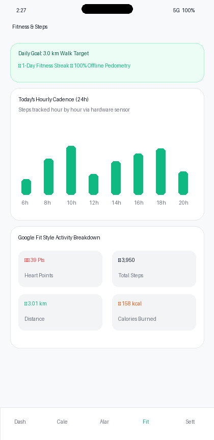

<p align="center">
  
</p>

<h1 align="center">Growth Streak</h1>

<p align="center">
  <strong>Active Accountability Tracker with Lock-Screen Alarms & Habit Streaks — Version 2.0</strong><br>
  <em>Strictly Offline-First • SQLite WAL Mode • Hardware Pedometer Fitness • 60s Camera Standing Pose Verification • 21 Custom Alarm Ringtones</em>
</p>

<p align="center">
  <a href="https://expo.dev/accounts/sakshamrajpoot/projects/growth-streaks"></a>
  <a href="https://reactnative.dev"></a>
  <a href="https://developer.android.com"></a>
  <a href="https://sqlite.org"></a>
  <a href="https://www.typescriptlang.org"></a>
</p>

---

## 📦 Direct APK Download

Download the latest standalone universal Android `.apk` directly (no developer tools or Expo Go required):

[-10B981?style=for-the-badge&logo=android)](https://expo.dev/artifacts/eas/_NnggjpKlmyg16DwLbMBJ3pVaUV9dsIlQ7EP5bI4Wiw.apk)

* **Direct Cloud APK Download:** [Download Growth Streak v2.0.apk](https://expo.dev/artifacts/eas/_NnggjpKlmyg16DwLbMBJ3pVaUV9dsIlQ7EP5bI4Wiw.apk)
* **EAS Cloud Build Dashboard:** [Build `f87159e7`](https://expo.dev/accounts/sakshamrajpoot/projects/growth-streaks/builds/f87159e7-f1c3-4735-8eb7-f8814985e15d)
* **Local Workspace File:** `Growth Streak.apk` (149 MB)

---

## 📸 App Screenshots (Version 2.0)

<p align="center">
  
  &nbsp;
  
  &nbsp;
  
  &nbsp;
  
  &nbsp;
  
</p>

---

## 🚀 Version 2.0 Breakthrough Features

### 🏃 1. Google Fit-Style Offline Movement & Step Tracker
* **100% Offline Pedometry:** Powered directly by Android's silicon-level hardware pedometer chip (`Sensor.TYPE_STEP_COUNTER` via `android.permission.ACTIVITY_RECOGNITION`). Zero battery drain, zero GPS tracking, zero cloud data leakage.
* **Real-Time Dynamic Metrics:** Live calculation of **Steps**, **Distance (km)**, **Calories Burned (kcal)**, and **Active Move Minutes**.
* **24-Hour Cadence Bar Graph:** Visualizes your steps taken across every individual hour of the day (0h to 23h).
* **Flexible Daily Goals:** Set customized streak targets (e.g., 3 km, 5 km, 250 kcal, 45 active minutes, or 10,000 steps).
* **Fitness Streak Accountability:** Reaching your chosen goal before 12:00 midnight locks in your fitness streak in green; missing it safely resets the streak.

### 📸 2. Wake-Up Alarm with 60-Second Camera Standing Verification
* **Anti-Snooze Standing Mechanism:** When a Wake-Up routine triggers, the alarm cannot be dismissed by a casual tap.
* **Slide to Unlock ➔:** An interactive slider pauses the audio and opens the front camera view with an ergonomic posture silhouette guide.
* **On-Device Offline Posture Detection:** Evaluates upright vertical alignment. If you remain lying in bed or face the camera away, the timer stays at `00` and does not decrement.
* **60-Second Standing Session:** Countdown starts only while verified standing. Performs strict verification checks every 10 seconds (minimum 4 of 6 checks required).
* **Anti-Loophole Protection:** If the camera is minimized, closed, or you sit back down before completing the full 60 seconds, **the loud alarm resumes ringing immediately**!
* **Morning Greeting:** Upon reaching 60 seconds of verified standing, a celebratory banner *"Good Morning! Have a great and productive day!"* silences the alarm and marks your streak complete.

### 🎵 3. 21 Custom Built-In Alarm Ringtones with Live Audio Preview
All 21 audio ringtones are bundled into the app assets with working `expo-av` playback and haptic feedback:
1. `Gentle Chime` — Soft harmonic wake chimes
2. `Digital Pulse` — Crisp electronic sequence
3. `Morning Bell` — Resonant temple bell tone
4. `Cosmic Synth` — Atmospheric progressive chord
5. `Sunrise Acoustic` — Warm uplifting guitar notes
6. `Energetic Beat` — Dynamic high-tempo wake rhythm
7. `Radar Alert` — High-priority sonar alert pulse
8. `Zen Flute` — Peaceful mindful meditation
9. `Celestial Harp` — Flowing ambient dream harp
10. `Upbeat Wake` — Motivating energetic rhythm
11. `Island Marimba` — Cheerful wooden marimba
12. `Mountain Echo` — Spacious reverberating melody
13. `Amber Melody` — Rich acoustic chords
14. `Quiet Sunrise` — Subtle serene dawn chime
15. `Future Clock` — Modern digital alarm pulse
16. `Heroic Rise` — Inspiring orchestral rise
17. `Ocean Breeze` — Calming natural wake harmony
18. `Focus Flow` — Smooth lofi productivity vibe
19. `Active Stride` — Brisk cadence motivation tone
20. `Crystal Calm` — Pure crystal glass resonance
21. `Urgent Call` — Assertive high-visibility alarm

### 📅 4. Strict Calendar Streak Engine (Zero False Red Marks)
* **Clean Blank Days:** Uncreated routines or past days before your download are left completely neutral and blank.
* **Green Day Mark:** Set alarm and completed at least 1 routine.
* **Red Day Mark:** Set alarm and missed/skipped without completing.
* **Today Indicator:** The green active highlight ring advances day by day.
* "Manage / Delete" mode with checkboxes on each routine card.
* One-click "Select All / Deselect All" toggle.
* Batch delete selected routines with confirmation dialog.

### 🌙 6. Unified Dark / Light Theme Engine
* High-contrast dark theme engineered for OLED and AMOLED displays.
* Seamlessly toggles backgrounds, navigation bars, cards, and text color palettes system-wide.

### 🏆 7. Fractional Accountability & Highest Streak Preservation
* Even a single completed routine preserves the active daily streak.
* Tracks both your **Current Day Streak** and your all-time **Highest/Best Streak**. If your active streak breaks, your highest record remains safely stored and displayed.

### 🔒 8. 100% Strictly Offline-First
* Zero tracking, zero analytics servers, zero remote API calls.
* All data is stored locally in an embedded SQLite database using WAL (Write-Ahead Logging) mode.

---

## 🛠️ Architecture & Tech Stack

| Layer | Technology | Details |
| :--- | :--- | :--- |
| **Framework** | **React Native 0.88 + Expo SDK 58** | New Architecture (TurboModules & Fabric enabled) |
| **Local Database** | **Expo SQLite (WAL Mode)** | Automated initial DDL migrations, zero cloud sync |
| **State Management** | **Zustand + MMKV** | High-performance synchronous key-value storage |
| **Alarm Scheduler** | **react-native-notify-kit** | Full-screen intent, priority channels, exact triggers |
| **Audio Synthesizer**| **Web Audio API + Expo Haptics** | Real-time audible tone preview on ringtone click |
| **Routing** | **Expo Router v4** | File-based typed routing (`app/(tabs)/`) |
| **Styling** | **Design Tokens & Theme Engine** | High-contrast Dark and Light color palettes |

---

## 💾 SQLite Database Schema

```sql
PRAGMA journal_mode = WAL;
PRAGMA foreign_keys = ON;

CREATE TABLE IF NOT EXISTS tasks (
    id                TEXT PRIMARY KEY,
    activity_name     TEXT NOT NULL,
    focus_area        TEXT NOT NULL DEFAULT 'General',
    scheduled_time    TEXT NOT NULL,
    days_of_week      TEXT NOT NULL DEFAULT '[1,2,3,4,5,6,7]',
    alarm_sound       TEXT NOT NULL DEFAULT 'default_alarm',
    pre_alarm_minutes INTEGER NOT NULL DEFAULT 5,
    is_active         INTEGER NOT NULL DEFAULT 1,
    created_at        INTEGER NOT NULL,
    updated_at        INTEGER NOT NULL
);

CREATE TABLE IF NOT EXISTS task_logs (
    id              TEXT PRIMARY KEY,
    task_id         TEXT NOT NULL,
    date            TEXT NOT NULL,
    status          TEXT NOT NULL DEFAULT 'pending',
    trigger_count   INTEGER NOT NULL DEFAULT 0,
    responded_at    TEXT,
    created_at      INTEGER NOT NULL,
    FOREIGN KEY (task_id) REFERENCES tasks(id) ON DELETE CASCADE,
    UNIQUE(task_id, date)
);

CREATE TABLE IF NOT EXISTS settings (
    key   TEXT PRIMARY KEY,
    value TEXT NOT NULL
);
```

---

## 🚀 Development & Local Setup

```bash
# Clone repository
git clone https://github.com/SakshamRajpoot10/Growth-Streaks.git
cd Growth-Streaks/growth-streaks

# Install dependencies
npm install

# Start development server
npx expo start

# Type check
npx tsc --noEmit --skipLibCheck

# Export web build
npx expo export -p web
```

---

## 📄 License

This project is licensed under the MIT License — see the [LICENSE](LICENSE) file for details.
