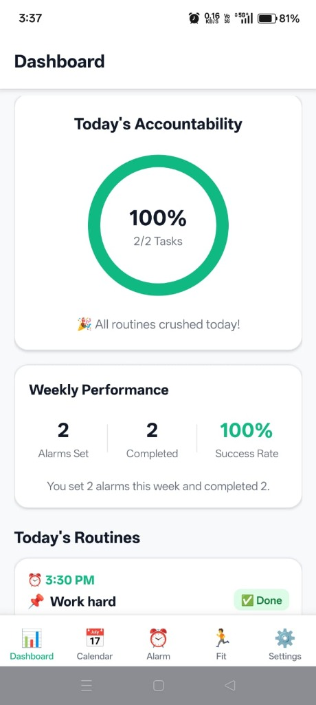
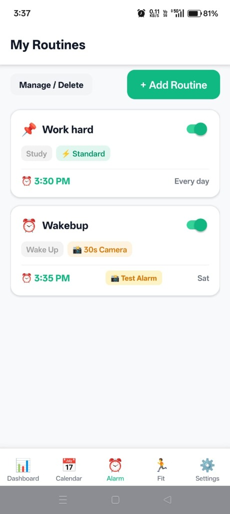
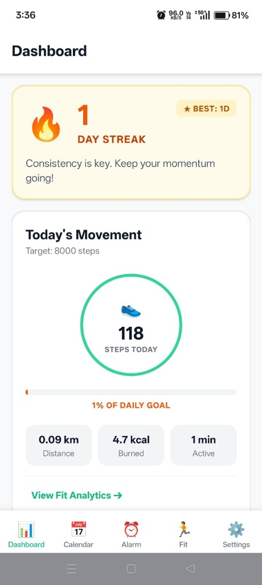
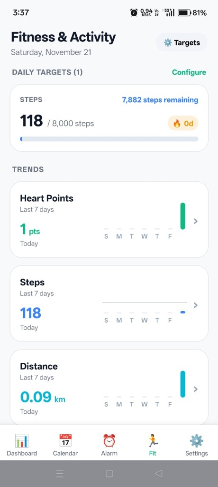
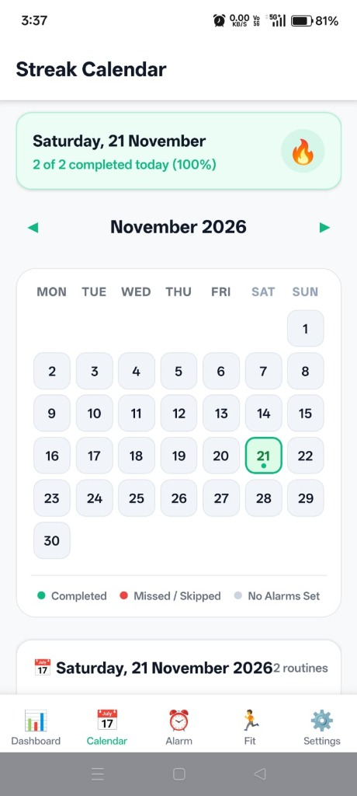
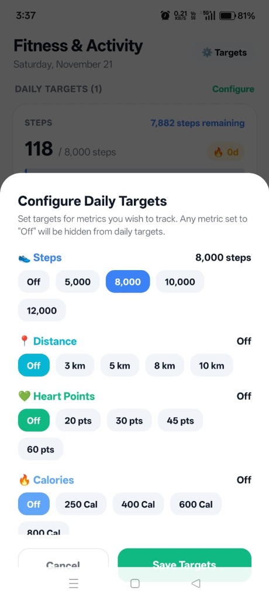

<p align="center">
  
</p>

<h1 align="center">StandUp — Habit Alarm & Daily Activity Tracker</h1>

<p align="center">
  <strong>The Complete On-Device Discipline & Accountability Operating System for Android</strong><br>
  <em>Reliable Locked-Screen Alarms • 30-Second Camera Standing Verification • 24/7 Hardware Pedometer • Habit Streak Calendar</em>
</p>

<p align="center">
  <a href="https://sakshamrajpoot10.github.io/Growth-Streaks/"></a>
  <a href="https://sakshamrajpoot10.github.io/Growth-Streaks/privacy-policy.html"></a>
  <a href="https://github.com/SakshamRajpoot10/Growth-Streaks/actions"></a>
  <a href="https://developer.android.com"></a>
  <a href="https://reactnative.dev"></a>
  <a href="https://www.typescriptlang.org"></a>
</p>

---

## 🚀 Live Web Links & Official Store Distribution

| Platform / Service | Direct Hyperlink | Status |
| :--- | :--- | :---: |
| 🌐 **Official Application Website** | **[sakshamrajpoot10.github.io/Growth-Streaks](https://sakshamrajpoot10.github.io/Growth-Streaks/)** | **`LIVE`** |
| 🔒 **Official Privacy Policy** | **[sakshamrajpoot10.github.io/Growth-Streaks/privacy-policy.html](https://sakshamrajpoot10.github.io/Growth-Streaks/privacy-policy.html)** | **`LIVE`** |
| 📄 **Terms of Service & EULA** | **[sakshamrajpoot10.github.io/Growth-Streaks/terms.html](https://sakshamrajpoot10.github.io/Growth-Streaks/terms.html)** | **`LIVE`** |
| 📢 **AdMob Publisher Authorization** | **[sakshamrajpoot10.github.io/Growth-Streaks/app-ads.txt](https://sakshamrajpoot10.github.io/Growth-Streaks/app-ads.txt)** | **`LIVE`** |
| 📱 **PhonePe Appstore (Indus)** | **[Download StandUp on PhonePe Appstore](https://www.phonepeappstore.com/apps/com.growthstreaks.standup)** | **`UNDER REVIEW`** |

> ℹ️ **Official Store Distribution Only:** StandUp was officially prepared, signed with production V2/V3 signatures, and submitted for publication review on the **PhonePe Appstore (Indus Appstore)** on **November 22, 2026**. StandUp is distributed exclusively through official store channels — no raw APK files are hosted or downloadable via GitHub to guarantee authenticity, security, and verified automatic updates. Once review concludes, the download link above directs directly to the store page for direct one-tap installation on Android devices across India and worldwide.

---

## 📱 Visual Showcase & Interface Gallery

Authentic screenshots captured directly from **StandUp** running on a physical Android smartphone:

<p align="center">
  
  &nbsp;
  
  &nbsp;
  
</p>

<p align="center">
  
  &nbsp;
  
  &nbsp;
  
</p>

| Screenshot | Feature Focus | User Experience Impact |
| :---: | :--- | :--- |
| **01** | **Today's Accountability** | Circular 100% completion ring, weekly task metrics, and daily morning checklist. |
| **02** | **My Routines & Alarms** | Active routines list showing "Wakebup" with 30s camera verification and instant Test Alarm trigger. |
| **03** | **Movement & Streak Fire** | Warm flame streak card ("Consistency is key") alongside real-time step and active calorie meters. |
| **04** | **Fitness & Activity Trends** | Google Fit-grade stacked trend bars for Heart Points, Steps, Distance, and hourly histograms. |
| **05** | **Streak Calendar** | Responsive monthly grid highlighting days with 100% routine completion in vibrant emerald. |
| **06** | **Daily Targets Config** | Modal to independently configure or disable goals for Steps, Distance, Heart Points, and Calories. |

---

## 🌟 Core Pillars of StandUp

Most alarm apps are too easy to snooze, and most habit trackers are passive checklists that get forgotten during sleep. StandUp bridges this divide by combining four specialized systems into one coherent, on-device discipline operating system:

### 1. ⏰ Native Locked-Screen Alarm Engine
* **Android `AlarmManager` Integration:** Schedules real-time RTC alarms using `setExactAndAllowWhileIdle()` and `setAlarmClock()`, guaranteeing alarm triggers across all Android Doze states.
* **Full-Screen Lockscreen UI:** Custom native activity (`StandUpAlarmActivity`) configured with `showWhenLocked="true"`, `turnScreenOn="true"`, and `FLAG_KEEP_SCREEN_ON` to wake device displays over pin/pattern locks.
* **Isolated `STREAM_ALARM` Audio Routing:** Audio streams through Android's system alarm channel, ringing at full volume even if media and ringer volumes are muted.
* **21 Built-in Audio Ringtones:** Bundled in `res/raw/` — from peaceful zen flutes and gentle chimes to urgent, high-energy siren pulses.
* **Reboot Resilience:** `StandUpBootReceiver` catches `ACTION_BOOT_COMPLETED`, `TIME_SET`, and `TIMEZONE_CHANGED` to reschedule active alarms immediately after phone reboots.

### 2. 📸 30-Second Camera Wake-Up Verification
* **Mandatory Upright Standing Check:** Dismissing morning wake-up alarms requires physically getting out of bed and maintaining an upright posture in front of the front-facing camera for 30 seconds.
* **100% Ephemeral In-Memory Processing:** Video frames are analyzed in volatile RAM in real-time solely to detect posture and face presence.
* **Absolute Privacy:** Zero photographs, video recordings, or facial templates are stored to disk or uploaded to any server. Hardware locks are released the exact millisecond the alarm disarms.

### 3. 🏃 24/7 Hardware Pedometer & Biomechanical Analytics
* **Zero Battery Drain:** Utilizes hardware sensor fusion (`Sensor.TYPE_STEP_COUNTER`) and Google Play Services `LocalRecordingClient` without GPS battery drain.
* **No Notification Shade Clutter:** Steps are collected continuously in the background without intrusive, permanent status-bar notification icons.
* **Intraday Analytics:** 24-hour hourly distribution bar charts, 7-day trend cards, and weekly comparisons calibrated against nice-number scaling algorithms.

### 4. 📅 Habit Streak Calendar & Accountability
* **Monthly Discipline Grid:** Real-time SQLite-backed streak tracking. Days where all morning routines are crushed illuminate with vibrant emerald status indicators.
* **Offline-First SQLite Architecture:** Fast local reads and writes using WAL (Write-Ahead Logging) mode; zero dependence on external cloud servers.

---

## 🛡️ Privacy, Security & Compliance

StandUp was engineered with an uncompromising privacy-first design, fully compliant with India's **Digital Personal Data Protection Act, 2023 (DPDP Act)** and international privacy standards:

* **Zero Mandatory Logins:** StandUp does not require usernames, passwords, phone numbers, or email addresses.
* **100% Local Data Custody:** All alarms, routines, streak histories, and step counts remain on the user's physical device in an encrypted local database.
* **Zero Biometric Retention:** The camera stream is discarded continuously in RAM.
* **Instant Data Erasure:** Clearing application data in Android settings or uninstalling the app permanently deletes all records.
* **Safe Monetization (AdMob Safety Lock):** Non-intrusive advertisements served by Google AdMob (`pub-9675414045566238`) are strictly blocked and programmatically suppressed while alarms ring or camera verification runs.

---

## 🛠️ Technical Stack & Architecture

```text
growth-streaks/
├── android/                         # Native Android Gradle configuration
│   ├── app/src/main/java/com/growthstreaks/standup/
│   │   ├── MainActivity.kt          # Splash & React Native Host Activity
│   │   ├── MainApplication.kt     # Application Context & Package Registry
│   │   ├── StandUpAlarmActivity.kt  # Fullscreen Lockscreen Alarm UI
│   │   ├── StandUpAlarmReceiver.kt  # Broadcast Receiver for AlarmManager intents
│   │   ├── StandUpAlarmService.kt   # Foreground Media Playback Audio Service
│   │   ├── StandUpBootReceiver.kt   # Reboot & Timezone Change Rescheduler
│   │   └── StandUpNativeModule.kt   # Native Bridge to React Native runtime
│   └── app/src/main/res/raw/        # 21 Embedded Audio Ringtones (.mp3 / .wav)
├── app/                             # Expo Router Navigation & Screen Layouts
├── docs/                            # GitHub Pages Web Application & Legal Dossier
│   ├── assets/                      # App icon and 6 high-resolution screenshots
│   ├── launch_dossier/              # Complete 13-phase audit and compliance reports
│   ├── index.html                   # Official StandUp Landing Page
│   ├── privacy-policy.html          # Official DPDP Act 2023 Privacy Policy
│   ├── terms.html                   # Official Terms of Service & EULA
│   └── app-ads.txt                  # Authorized AdMob Seller Verification
├── .github/workflows/
│   ├── build-android.yml            # CI/CD: Automated APK & AAB Compilation
│   └── deploy-pages.yml             # CI/CD: Automated GitHub Pages Deployment
└── src/
    ├── components/                  # Reusable UI Primitives (Badges, Cards, Rings)
    ├── constants/                   # Brand Palette, Typography & Sound Mappings
    ├── features/                    # Feature Modules (Alarm, Fitness, Routine Tasks)
    └── services/                    # Local SQLite Database & AdMob Service Bridge
```

| Component | Specification |
| :--- | :--- |
| **Framework** | React Native 0.88.1 + Expo SDK 58.0.25 (New Architecture Enabled) |
| **Programming Languages** | TypeScript 5.9.3 (Strict) & Kotlin 2.2 |
| **Target Android Platform** | Target SDK: **API 36 (Android 16)** &bull; Compile SDK: **API 37** &bull; Min SDK: **API 24 (Android 7.0+)** |
| **Supported ABIs** | `arm64-v8a` (64-bit), `armeabi-v7a` (32-bit), `x86_64`, `x86` |
| **Database Engine** | `expo-sqlite` with SQLite WAL Mode |
| **Audio Pipeline** | Android `AudioManager.STREAM_ALARM` via `MediaPlayer` in Native Service |
| **Sensors** | Android `Sensor.TYPE_STEP_COUNTER` + Google Play Services `LocalRecordingClient` |
| **CI/CD Build System** | Automated GitHub Actions on `ubuntu-latest` with native Android NDK 27 |

---

## 📦 Local Development & Build Setup

### Prerequisites
* **Node.js** $\ge 18.x$ (LTS recommended)
* **JDK** 17 or higher
* **Android SDK** Platform Tools & Build-Tools $\ge 34.0.0$

### 1. Clone & Install
```bash
git clone https://github.com/SakshamRajpoot10/Growth-Streaks.git
cd Growth-Streaks/growth-streaks
npm install
```

### 2. Run Local Bundler
```bash
npx expo start
```

### 3. Application Distribution
StandUp is distributed **exclusively through the official PhonePe Appstore (Indus Appstore)**. Raw APK binary files are deliberately excluded from this repository to protect intellectual property, prevent unauthorized cloning, and ensure all users install verified, cryptographically signed builds with automatic store updates.

👉 **[Download StandUp on PhonePe Appstore](https://www.phonepeappstore.com/apps/com.growthstreaks.standup)**

---

## ⚖️ Legal Ownership & Intellectual Property

* **Application Name:** StandUp: Habit Alarm & Tracker
* **Package Identifier:** `com.growthstreaks.standup`
* **Creator & Sole Owner:** **Saksham Rajpoot**
* **Developer Support:** `sakshamrajpoot094@gmail.com`
* **Website:** [https://sakshamrajpoot10.github.io/Growth-Streaks/](https://sakshamrajpoot10.github.io/Growth-Streaks/)
* **Copyright:** &copy; 2026 Saksham Rajpoot. All rights reserved.
