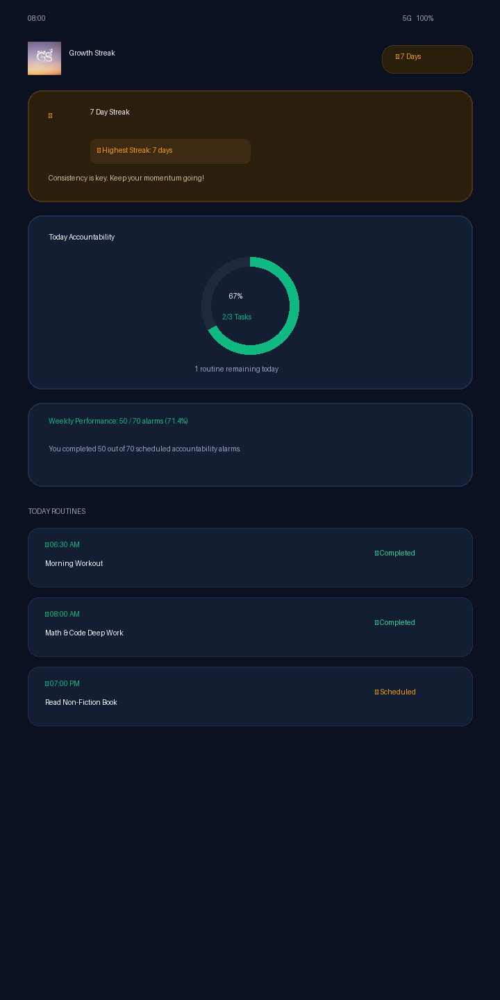
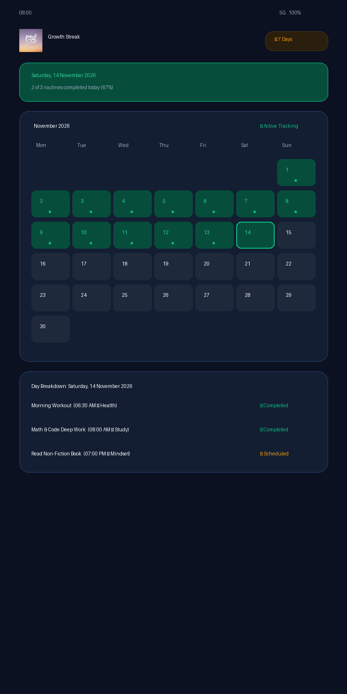
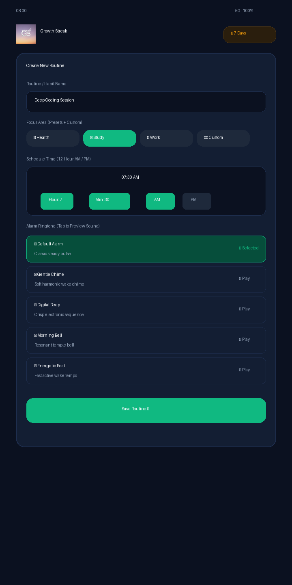
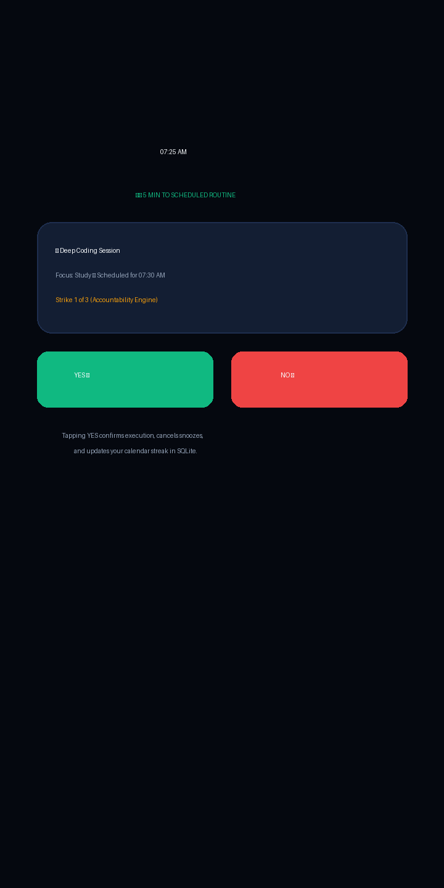

<p align="center">
  
</p>

<h1 align="center">Growth Streak</h1>

<p align="center">
  <strong>Active Accountability Tracker with Lock-Screen Alarms & Habit Streaks</strong><br>
  <em>Strictly Offline-First • SQLite WAL Mode • 3-Strike Snooze Engine • 12-Hour AM/PM • 10 Alarm Ringtones</em>
</p>

<p align="center">
  <a href="https://expo.dev/accounts/sakshamrajpoot/projects/growth-streaks"></a>
  <a href="https://reactnative.dev"></a>
  <a href="https://developer.android.com"></a>
  <a href="https://sqlite.org"></a>
  <a href="https://www.typescriptlang.org"></a>
</p>

---

## 📦 Direct APK Download

Download the latest standalone universal Android `.apk` directly (no developer tools or Expo Go required):

[-10B981?style=for-the-badge&logo=android)](https://expo.dev/artifacts/eas/cIIBIvWk6n8mergwxWEXDpyZnddtR-CmemubXCuBlmc.apk)

* **Direct APK Download Link:** [https://expo.dev/artifacts/eas/cIIBIvWk6n8mergwxWEXDpyZnddtR-CmemubXCuBlmc.apk](https://expo.dev/artifacts/eas/cIIBIvWk6n8mergwxWEXDpyZnddtR-CmemubXCuBlmc.apk)
* **Local Workspace File:** `Growth Streak.apk` (112 MB)

---

## 📸 App Screenshots

<p align="center">
  
  &nbsp;&nbsp;
  
  &nbsp;&nbsp;
  
  &nbsp;&nbsp;
  
</p>

---

## 🚀 Key Features

### ⏰ 1. Strict 3-Strike Lock-Screen Alarm Engine
Unlike passive reminder apps that send silent push banners, Growth Streak triggers aggressive lock-screen alarms using Android Full-Screen Intent notifications:
* **Trigger 1 (T-5 min):** First accountability prompt fires 5 minutes before your scheduled routine.
* **Trigger 2 (T-3 min):** Second warning fires 2 minutes later if ignored.
* **Trigger 3 (T-0 min):** Final call fires precisely at routine time.
* **Auto-Fail (T+5 min):** Automatically registers `NO / Missed` in SQLite if all 3 triggers are ignored.
* **Interactive Lock-Screen Buttons:** Tap **`[ YES ]`** to log completion & immediately cancel remaining snoozes; tap **`[ NO ]`** to skip.

### 📅 2. Comprehensive Calendar Grid & Heatmap (1 to 30/31 Days)
* Full 7-column matrix properly aligned with Monday–Sunday weekday offset spacers.
* **Green Badge:** Set alarms and completed routines.
* **Red Badge:** Set alarms and missed/skipped routines.
* **Blank / Normal Default:** No alarms set for that day.
* **Day Breakdown Sheet:** Tap any date on the calendar to view its logged routines, times, focus areas, and execution status.

### 🕒 3. 12-Hour AM/PM Picker & Custom Focus Areas
* User-friendly 12-Hour format with Hour, Minute, and **`[ AM ]`** / **`[ PM ]`** selectors.
* Built-in focus area presets (**Health**, **Study**, **Work**, **Fitness**, **Mindset**, **Finance**) plus a **`✏️ Custom`** option to type any routine.

### 🔔 4. 10 Built-In Alarm Ringtones with Live Audio Preview
Tap any of the 10 included alarm sounds to preview its tone in real time with haptic feedback:
1. `Default Alarm` (Classic steady pulse)
2. `Gentle Chime` (Harmonic wake chime)
3. `Digital Beep` (Crisp electronic sequence)
4. `Morning Bell` (Resonant temple bell)
5. `Sunrise Acoustic` (Uplifting ascending notes)
6. `Energetic Beat` (Fast active wake tempo)
7. `Radar Alert` (Sonar alert pulses)
8. `Cosmic Synth` (Atmospheric chord)
9. `Rooster Call` (Traditional morning wake)
10. `Zen Flute` (Mindful meditation chime)

### 🗑️ 5. Multi-Select Batch Deletion & Single Deletion
* "Manage / Delete" mode with checkboxes on each routine card.
* One-click "Select All / Deselect All" toggle.
* Batch delete selected routines with confirmation dialog.

### 🌙 6. Unified Dark / Light Theme Engine
* High-contrast dark theme engineered for OLED and AMOLED displays.
* Seamlessly toggles backgrounds, navigation bars, cards, and text color palettes system-wide.

### 🏆 7. Fractional Accountability & Highest Streak Preservation
* Even a single completed routine preserves the active daily streak.
* Tracks both your **Current Day Streak** and your all-time **Highest/Best Streak**. If your active streak breaks, your highest record remains safely stored and displayed.

### 🔒 8. 100% Strictly Offline-First
* Zero tracking, zero analytics servers, zero remote API calls.
* All data is stored locally in an embedded SQLite database using WAL (Write-Ahead Logging) mode.

---

## 🛠️ Architecture & Tech Stack

| Layer | Technology | Details |
| :--- | :--- | :--- |
| **Framework** | **React Native 0.88 + Expo SDK 58** | New Architecture (TurboModules & Fabric enabled) |
| **Local Database** | **Expo SQLite (WAL Mode)** | Automated initial DDL migrations, zero cloud sync |
| **State Management** | **Zustand + MMKV** | High-performance synchronous key-value storage |
| **Alarm Scheduler** | **react-native-notify-kit** | Full-screen intent, priority channels, exact triggers |
| **Audio Synthesizer**| **Web Audio API + Expo Haptics** | Real-time audible tone preview on ringtone click |
| **Routing** | **Expo Router v4** | File-based typed routing (`app/(tabs)/`) |
| **Styling** | **Design Tokens & Theme Engine** | High-contrast Dark and Light color palettes |

---

## 💾 SQLite Database Schema

```sql
PRAGMA journal_mode = WAL;
PRAGMA foreign_keys = ON;

CREATE TABLE IF NOT EXISTS tasks (
    id                TEXT PRIMARY KEY,
    activity_name     TEXT NOT NULL,
    focus_area        TEXT NOT NULL DEFAULT 'General',
    scheduled_time    TEXT NOT NULL,
    days_of_week      TEXT NOT NULL DEFAULT '[1,2,3,4,5,6,7]',
    alarm_sound       TEXT NOT NULL DEFAULT 'default_alarm',
    pre_alarm_minutes INTEGER NOT NULL DEFAULT 5,
    is_active         INTEGER NOT NULL DEFAULT 1,
    created_at        INTEGER NOT NULL,
    updated_at        INTEGER NOT NULL
);

CREATE TABLE IF NOT EXISTS task_logs (
    id              TEXT PRIMARY KEY,
    task_id         TEXT NOT NULL,
    date            TEXT NOT NULL,
    status          TEXT NOT NULL DEFAULT 'pending',
    trigger_count   INTEGER NOT NULL DEFAULT 0,
    responded_at    TEXT,
    created_at      INTEGER NOT NULL,
    FOREIGN KEY (task_id) REFERENCES tasks(id) ON DELETE CASCADE,
    UNIQUE(task_id, date)
);

CREATE TABLE IF NOT EXISTS settings (
    key   TEXT PRIMARY KEY,
    value TEXT NOT NULL
);
```

---

## 🚀 Development & Local Setup

```bash
# Clone repository
git clone https://github.com/SakshamRajpoot10/Growth-Streaks.git
cd Growth-Streaks/growth-streaks

# Install dependencies
npm install

# Start development server
npx expo start

# Type check
npx tsc --noEmit --skipLibCheck

# Export web build
npx expo export -p web
```

---

## 📄 License

This project is licensed under the MIT License — see the [LICENSE](LICENSE) file for details.
