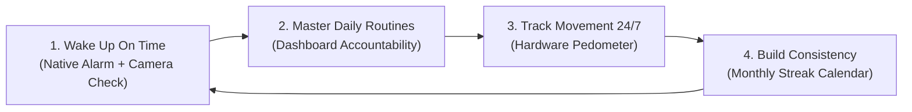

# Phase 3 — Final Brand Positioning Framework
**Application Name:** StandUp  
**Package Identifier:** `com.growthstreaks.standup` (Preserved permanently)  
**Target Distribution:** PhonePe Appstore ONLY  
**Brand Positioning Statement:** *"Wake Up. Move More. Build Consistency."*

---

## 1. Core Brand Architecture: The Connected Discipline Loop

StandUp is not an alarm clock with an unrelated pedometer tacked on; it is positioned as a **single, connected daily discipline operating system**:

### The Three Pillar Benefits:
1. **Pillar 1 — Morning Discipline:** Overcome the snooze cycle with loud native alarms and an interactive 30-second upright standing posture check.
2. **Pillar 2 — Daily Physical Movement:** Automatically measure daily walking steps, distance, active minutes, and estimated calorie burn without battery drain or permanent notifications.
3. **Pillar 3 — Habit Accountability:** Build long-term streaks with a responsive calendar grid that visually highlights days with 100% routine completion.

---

## 2. Brand Governance & Style Rules

1. **Strict Singular Branding:** The app is named **StandUp** across all store metadata, graphics, descriptions, and user interfaces. The historical working title "Growth Streaks" is strictly retired from all consumer-facing text.
2. **Package Identity Retention:** The native Android package ID remains `com.growthstreaks.standup`. This maintains binary stability, database integrity, and system compatibility across updates.
3. **Non-Medical Boundary:** StandUp is strictly a wellness, motivation, and discipline tool. It must never be marketed as a medical device or diagnostic instrument.
4. **Authenticity in Advertising:** All marketing copy must reflect real, working functionality verified in the production APK (e.g., 21 custom embedded ringtones, 30s camera check, hardware step sensor, local SQLite database).
5. **Tone of Voice for Indian Users:** Professional, motivating, clear, and direct. Avoid tech jargon and avoid exaggerated buzzwords.
