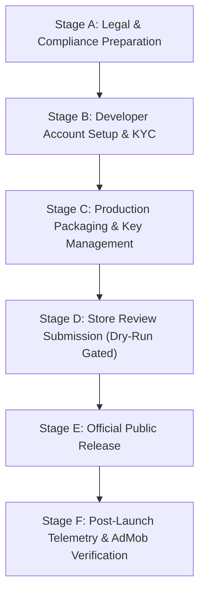

# STANDUP — Master Launch Readiness Plan
**Document Version:** 1.0.0 (Pre-Launch Dossier)  
**Classification:** Confidential / Owner Legal Planning  
**Target Application:** StandUp — Discipline & Habit Alarm OS  
**Package Identifier:** `com.growthstreaks.standup`  
**Authoritative Repository:** [https://github.com/SakshamRajpoot10/Growth-Streaks](https://github.com/SakshamRajpoot10/Growth-Streaks) (Branch: `main`)  
**Primary Distribution Targets:**  
1. PhonePe Appstore (formerly Indus Appstore) — Priority 1  
2. Samsung Galaxy Store — Priority 2  
3. Google Play Store — Priority 3 (Optional / Conditional upon Owner Approval)

---

## 1. Executive Summary & Objective

The objective of this dossier is to establish a rigorous, legally protected, evidence-based roadmap for publishing **StandUp — Discipline & Habit Alarm OS** across major tier-1 alternative and mainstream Android marketplaces.

This plan enforces the following fundamental governance mandates:
1. **Absolute Intellectual Property Retention:** All original source code, designs, branding, and commercial rights remain strictly vested in the application owner.
2. **Account & Revenue Autonomy:** All developer accounts, payment profiles, AdMob monetization streams, and signing keystores remain under the owner's direct and exclusive control.
3. **No Unilateral Publishing:** No public submissions, financial transactions, legal agreements, or account credential bindings will occur during this planning phase.
4. **Empirical Fact-Checking:** Every technical and legal assertion is verified directly against repository code, compiled binaries, and official store documentation.

---

## 2. Store Selection & Strategic Ranking

| Marketplace | Primary Geographic Focus | Commercial Terms | Strategic Advantage | Priority Status |
| :--- | :--- | :--- | :--- | :--- |
| **PhonePe Appstore** | India (Domestic Market) | Free 1st year registration; 0% commission on in-app payments | Massive distribution in India; frictionless localized onboarding; zero platform commission | **Priority 1 (Target Launch)** |
| **Samsung Galaxy Store** | Global (Pre-installed on all Samsung Galaxy devices) | Free registration; no annual fees; AdMob officially supported | Global reach on 1+ billion active Samsung devices; direct AdMob app-linking eligibility | **Priority 2 (Target Launch)** |
| **Google Play Store** | Global | US$25 one-time registration fee; strict 12-tester / 14-day closed testing mandate | Global universal marketplace | **Priority 3 (Optional / On Owner Approval)** |

---

## 3. High-Level Launch Milestones (Stages A Through F)

The launch sequence is strictly gated across six sequential phases:

### Stage A: Preparation (Current Planning Stage)
- Audit root `LICENSE` file and third-party dependencies.
- Draft custom, legally compliant Indian DPDP Act 2023 Privacy Policy and Terms of Service.
- Audit genuine device screenshots provided by the owner.
- Establish baseline production signing strategy.

### Stage B: Store Account Setup (Owner-Executed)
- Owner creates individual developer accounts on PhonePe Appstore and Samsung Seller Portal.
- Owner submits personal KYC documents (PAN, Aadhaar/Passport, Bank account verification) directly via official portal interfaces.
- Zero credential collection in markdown or repositories.

### Stage C: Production Packaging & Signing Key Management
- Generate a dedicated, cryptographically secure production signing keystore (`standup-release.keystore`, RSA-2048/4096 SHA-256).
- Securely store the keystore and passwords offline in the owner's custody.
- Build production release binaries (APK for PhonePe/Samsung, and optional AAB for Google Play).
- Verify SHA-256 binary fingerprints and manifest declarations.

### Stage D: Store Submission (Pre-Submission Review)
- Upload binaries and metadata to PhonePe Developer Portal and Samsung Seller Portal.
- Provide comprehensive reviewer instructions explaining the lock-screen alarm and camera verification features.
- Review all declaration forms before final submission.

### Stage E: Publication & Store Rollout
- Await store QA certification and review approval.
- Set publication mode to manual or scheduled release upon owner confirmation.
- Verify live listing availability in store catalog search.

### Stage F: Post-Launch & Revenue Monetization
- Link approved Samsung Galaxy Store listing in Google AdMob Console to achieve full ad serving.
- Deploy `app-ads.txt` to the owner's developer website root.
- Monitor crash rates, alarm wake-up delivery rates, and user reviews.

---

## 4. Key Risks & Mitigation Protocol

1. **AdMob Store Linking Risk:**  
   *Risk:* PhonePe Appstore is not currently on Google AdMob's supported third-party store list.  
   *Mitigation:* Simultaneously publish on Samsung Galaxy Store (which is on AdMob's supported list) and link the matching package `com.growthstreaks.standup` to unlock global AdMob ad serving.
2. **Special Permissions Scrutiny (`USE_FULL_SCREEN_INTENT`, `USE_EXACT_ALARM`):**  
   *Risk:* Both Samsung and Google strictly police full-screen alarm and exact timer permissions.  
   *Mitigation:* Provide reviewers with clear architectural documentation explaining that StandUp is an alarm clock and discipline OS requiring exact wake-up triggers and lock-screen takeover.
3. **Repository License Discrepancy:**  
   *Risk:* Root `LICENSE` currently credits Expo (650 Industries, Inc.) under MIT.  
   *Mitigation:* Retain third-party notices in a separate `THIRD_PARTY_NOTICES.md` file while replacing the root declaration with the owner's proprietary copyright notice for original application code.
